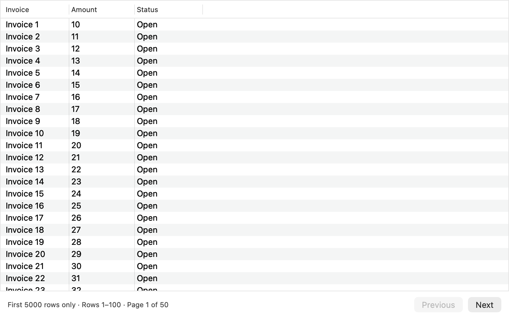

# CSV and TSV table previews

Parse CSV and TSV fields positionally, preserving duplicate headers, quoted delimiters and short rows. The native table provides stable numeric/text sorting, keeps blank cells last and shows 100 rows per page.

Previews retain the first 5000 data rows. The parser reads one additional row to detect truncation; when more rows exist, the footer says “First 5000 rows only.” Sorting and page counts apply to the retained preview rows. Files with exactly 5000 data rows keep the ordinary count. SwiftCSV's header-inclusive parser limit is accounted for explicitly.

Validation: universal Release Xcode build; 25 headless production/native-table checks, including visible truncation and the exact-limit boundary; inspected PNG capture; full strict SwiftLint and pinned SwiftFormat 0.58.6. Checks render actual controllers in unshown offscreen windows. The earlier missing-notice reproduction failed before the fix. No installed-app or Finder service changes.

Reproduce with `scripts/test-table-navigation.sh RELEASE_PRODUCTS SCRATCH_OUTPUT` after an isolated Release build. CSV parsing and navigation are prepared together as one contribution against upstream main.
